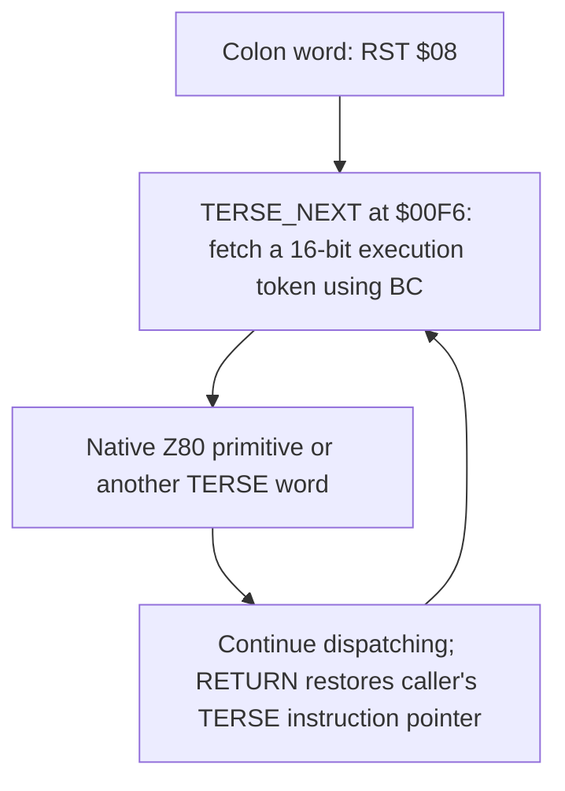
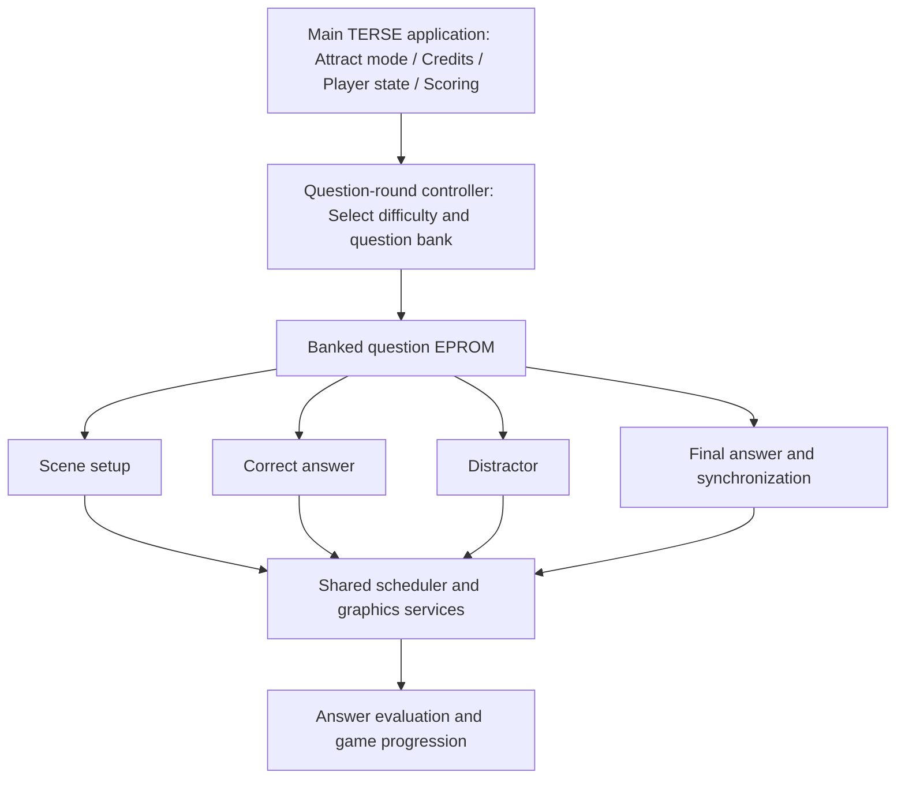

# Professor Pac-Man — TERSE reverse-engineering reassessment

Repository: [lizard43/profpac](https://github.com/lizard43/profpac) · 1983 · Dave Nutting Associates · Z80

## 1. Overall assessment

**Professor Pac-Man is one of the strongest pieces of evidence in our DNA TERSE evolution research.**

The repository documents a substantially more sophisticated TERSE implementation than the early compact engines. It contains a mature native Z80 vocabulary, direct-threaded application code, ROM banking, cooperative task scheduling, and executable question modules.

The key architectural distinction is that Professor Pac-Man uses TERSE for considerably more than isolated gameplay routines. The recovered application covers the main game executive, self-test and operator functions, question selection, answer presentation, scoring, and numerous supporting operations.

This makes it especially valuable alongside Sea Wolf II, Gorf, Extra Bases, and Robby Roto.

## 2. Where the reverse engineering stands

The repository is considerably further along than an ordinary starter disassembly. Its documentation records the following accomplishments:

| Area | Recovered state |
|---|---|
| Original ROMs | 9 program ROMs and 14 question ROMs |
| Native Z80 | 4,226 decoded instructions, covering 7,627 bytes |
| Program TERSE | 357 colon definitions, 4,925 threaded cells |
| Question TERSE | 401 reachable family definitions, 10,532 threaded cells |
| Question organization | 130 initializers, grouped into 45 families |
| Graphics | 193 reachable question images decoded |
| Hardware | Memory banking, video, sound, input, and programmable logic analyzed |
| Build | Documented byte-exact ROM and archive verification |

These are the repository's reported results. I have verified the source inventory and documentation, but have not independently executed the build or reproduced all its analysis checks.

The important finding is that **the work is already at the architectural and application-reconstruction stage**, not merely at the opcode-discovery stage.

## 3. The TERSE implementation

The recovered kernel is a direct-threaded Z80 interpreter.

The register arrangement is especially important:

| Register | Role |
|---|---|
| `BC` | TERSE instruction pointer |
| `IY` | Cached interpreter continuation |
| `IX` | TERSE return/control stack |
| `SP` | Parameter stack and balanced native-call stack |
| `HL`, `DE` | Operands and intermediate values |

The repository identifies:

- `$0008` — colon-entry handler
- `$00F2` — interpreter initialization
- `$00F6` — `NEXT` dispatcher
- `$00FD–$05B7` — foundational native TERSE vocabulary

These details provide concrete comparison points against our recovered Gorf and Sea Wolf II interpreters.

The vocabulary includes stack manipulation, arithmetic, branch and loop words, arrays, local variables, frames, memory access, and hardware port access. It also contains special protected-memory operations adapted to the Professor Pac-Man hardware.

One particularly useful finding is the repository's observation that Professor Pac-Man retains much of Gorf's foundational dictionary organization while implementing some operations natively that Gorf represented as colon definitions.

That gives us a measurable progression in language implementation, rather than just a common interpreter signature.

## 4. The significant advance: executable question cartridges

Professor Pac-Man has an unusual program organization.

The fourteen populated question EPROMs do not simply store question text and answers. They contain executable TERSE definitions, animation instructions, graphics, and parameters.

The program uses a shared controller to select a question and invoke a bank-specific presentation.

That modular division is a major result of the earlier RE.

The controller does not need to understand how every question is animated or constructed. A selected initializer returns an action-list address, and the shared TERSE scheduler runs that question's presentation.

This demonstrates that the DNA threaded system had become a reusable application framework supporting independently banked executable content.

## 5. How this fits the DNA TERSE evolution story

Architectural progression, with established game dates:

| Period | Game/system | Evolutionary significance |
|---|---|---|
| 1976–1978 | Tornado Baseball / Double Play / Extra Inning | Earlier 8080 interpreter lineage. Establish the compact dispatch and application representation techniques leading into DNA's later systems. |
| 1978 | Sea Wolf II | Early production TERSE. Compact native vocabulary and the foundational Z80 threaded execution model. |
| 1979 | Extra Bases / Gorf | Expanded game-specific TERSE applications, larger dictionaries and mature native-word interfaces. |
| 1981–1982 | Astrocade console prototypes | Coloring Book and Cosmic Raiders use a shared compact TERSE runtime for console cartridge development. |
| 1982 | Robby Roto | The surviving Ice Terse V.19 source provides evidence of the contemporary high-level language, compiler and game vocabulary. |
| 1983 | Professor Pac-Man | A production arcade application uses TERSE with a large native vocabulary, task scheduler, banked executable question modules and game-wide application control. |

This adds an important chapter to our evolution document.

The early interpreter work explains the dispatch mechanisms. Sea Wolf II demonstrates production TERSE on the Z80. Gorf and Extra Bases demonstrate more substantial application vocabularies. The console prototypes show how a compact TERSE execution system could be adapted to cartridge development.

**Professor Pac-Man shows how those ideas scaled to a larger, modular production arcade application.**

A particularly compelling distinction is the use of separate program and question ROM banks containing executable threaded words. This goes beyond the shared 688/693-byte cartridge runtime we have been examining in Coloring Book and Cosmic Raiders.

The two systems express related DNA architectural ideas at very different scales.

## 6. Problems discovered in the repository

There is one immediate problem that changes the next steps.

**The current `main` branch is missing files required by its own build script.**

I checked the complete GitHub repository tree against `build.sh`.

| Required by build | Current state |
|---|---|
| `tools/zmac` | Present |
| `src/profpac_common.include` | Present |
| `src/profpac_question_common.include` | Missing |
| `tools/analyze_question_families.py` | Missing |
| `tools/analyze_ppq_graphics.py` | Missing |
| `tools/analyze_question_round.py` | Missing |
| `tools/analyze_game_progression.py` | Missing |
| `tools/decode_pls153a.py` | Missing from `tools/` |
| `roms/orig/profpac.zip` | Present |

Some analysis scripts exist at the repository root under different names, and historical question includes exist in `temp/`.

However, the active build requires the missing files at their specified locations. It will fail its prerequisite checks before assembling anything.

The repository also currently depends on Python for archive construction and validation. That differs from the simpler zmac-centered build pattern we've established for our other projects.

There are also source-quality issues worth addressing:

- The native source still contains generic labels such as `L001B` and `L0053`.
- Some threaded definitions retain address-derived names such as `TERSE_COLON_82E0`.
- Large sections of graphics and tables remain plain `DB` data.
- The README references a `self_test.md` document that is absent.
- Each question ROM has a duplicate timestamped assembly copy, which adds noise without providing an independently different source.

These findings do not negate the recovered architecture. They show that the documented RE is more mature than the current repository's organization and build completeness.

## 7. Recommended next RE stages

### Stage 1 — Restore the reproducible build (immediate)

Reconcile missing includes and analyzers, preserve the original ROMs, and establish byte-exact assembly for all 23 processor-visible devices. Simplify the build scripts while preserving important validation.

**Checkpoint note:** The original RE was performed offline. The user will inspect the offline work to determine whether required files were inadvertently omitted from source control. Do not fabricate replacements or silently change the established RE to work around missing files.

### Stage 2 — Cross-generation interpreter comparison

Compare Professor Pac-Man's kernel byte by byte with Sea Wolf II, Gorf, Extra Bases, and the 1982 Robby Roto interpreter. Record exact native matches, changed implementations, new words, altered calling conventions and dictionary ordering.

The goal is a supported TERSE family tree, not just a list of similar words.

### Stage 3 — Source and dictionary cleanup

Follow our current RE standards: meaningful labels, function headers, inline comments, symbolic TERSE execution tokens, named callers, stack effects, and graphics represented with useful inline visual annotations.

Produce a unified dictionary in the same style as the Coloring Book and Cosmic Raiders dictionaries, with addresses beneath word names and explicit native/colon implementation types.

### Stage 4 — Reconstruct TERSE's application framework

Trace the scheduler, frames, cooperative yielding, bank switching, and one complete question family from entry to return.

Then connect those mechanisms to equivalent constructs in Gorf, Robby Roto and the Astrocade console prototypes.

## 8. What I would add to the DNA evolution document

Professor Pac-Man deserves its own substantial section, centered on three concrete findings.

First, the mature TERSE vocabulary. We can illustrate how the small Sea Wolf II kernel developed into the larger Gorf-style execution environment visible in Professor Pac-Man.

Second, the application framework. The game demonstrates TERSE managing cooperative tasks, screen objects, events, question selection, game state, and operator functions.

Third, the banked executable modules. Professor Pac-Man provides a particularly clear example of TERSE code separated into a common executive and multiple independently selected content modules.

This third finding is potentially the strongest illustration in the chapter: a single question family can be followed from its bank directory through TERSE initialization, child actions, graphics rendering, answer selection, and completion.

## Final assessment

The repository is a **mature, extensively documented RE with a currently incomplete build setup**. We should preserve the existing architectural discoveries and concentrate on reproducibility, source cleanup, and cross-generation comparisons rather than restarting the disassembly.

For our historical narrative, Professor Pac-Man demonstrates that by 1983, DNA's TERSE architecture supported a substantial production arcade game with modular executable content and a sophisticated shared runtime.

The most valuable next investigation is a direct comparison of the Professor Pac-Man interpreter and vocabulary against our known 1979 and 1982 TERSE versions. That is how we can move from demonstrating a shared architecture to reconstructing its actual development history.

---

Checkpoint created 2026-10-31. This document records an assessment only. No ROM, source, interpreter, or build changes are authorized by the checkpoint itself.
