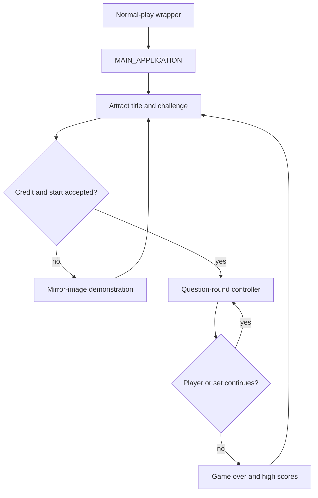

# Main game progression

Professor Pac-Man's normal application is a cooperative TERSE task graph in
program-bank configuration 1. The fixed wrapper at `$DEBD` selects that bank
and calls `MAIN_APPLICATION` at `$BE66`. The application validates retained
RAM, initializes the display and scheduler, and enters `MAIN_PROGRESSION_TASK`
at `$BCDB`. The question controller temporarily selects configuration 0 and
returns through the one-action list at `$DECB`.

The complete configuration-1 progression closure contains 60 colon
definitions, 1,960 TERSE cells, and 11 counted action lists in `pps8` and
`pps9`. `tools/analyze_game_progression.py` validates the closure, list
membership, semantic roots, and structured source on every build.

## Application cycle



`MAIN_PROGRESSION_TASK` starts three persistent control tasks: start/turn
control, attract sound, and coin/credit control. While no start is accepted it
alternates the challenge prompt with a complete mirror-image demonstration.
The credit/start footer remains a separate child action, allowing coin and
start state to interrupt the attract presentation without embedding input
polling in the drawing tasks.

## Credits and start selection

`START_GAME_CONTROL_TASK` is the gate between attract mode and play. It waits
until `CREDIT_COUNT_ADDR` is positive or `FREE_PLAY_FLAG_ADDR` is set, reads
port `$10`, complements the active-low inputs, rotates start bits 4 and 5 into
bits 0 and 1, and rejects values outside the one-player/two-player selection.
Coin play limits the selection to the available credit count; free play
accepts either start button. The accepted selection initializes:

- the game/round mode and current-player selector;
- the player-one and player-two four-byte scores;
- question, response, and completion flags;
- the display/task environment used by `QUESTION_ROUND_CONTROLLER`.

The one-player path maintains player-one state only. The two-player path keeps
separate score and round-count fields and changes `CURRENT_PLAYER_INDEX_ADDR`
at the fixed question-controller boundary. Both paths invoke the same question
executive through `QUESTION_ROUND_VECTOR` at `$C01C`.

## Attract presentation

| Action list | Work |
| --- | --- |
| `MAIN_CONTROL_ACTIONS` | Start/turn control, attract sound, and coin/credit control |
| `ATTRACT_CHALLENGE_PROMPT_ACTIONS` | Free-play or insert-coin challenge screen |
| `ATTRACT_DEMO_QUESTION_ACTIONS` | “Which is the mirror image?” demonstration |
| `CREDIT_START_PROMPT_ACTIONS` | Credit counter and one-player/two-player prompt |

The demonstration is executable game machinery, not a prerecorded sequence.
`ATTRACT_MIRROR_DEMO_ACTIONS` creates the scene, correct image, and distractor
objects as three scheduler tasks. Its prompt and graphics are resident in
`pps8`; no PPQ bank is selected. `ATTRACT_TITLE_AND_SCORE_TASK` supplies the
title/high-score portion of the cycle, while `ATTRACT_CHALLENGE_PROMPT_TASK`
selects the coin or free-play message from retained operator state.

## Question and score progression

An accepted start initializes both four-byte player scores to zero and derives
the initial difficulty from the operator setting. `QUESTION_ROUND_CONTROLLER`
then owns the repeated question cycle: tier selection, answer timing,
correctness, score arithmetic, per-player round counts, turn selection, and
bonus scheduling. Configuration 1 remains the application shell around that
controller.

Normal question selection advances through eight six-question tiers. A bonus
question uses the upper four directory tiers and doubles the visible scoring
path. Correct responses add the response-time-dependent award; wrong or
expired responses follow the fruit-loss path. The controller updates the
active player's score and returns through `MAIN_PROGRESSION_ACTIONS` when the
set or player state requires an application-level transition. The exact
question-cycle branches and state fields are documented in
[question_round.md](question_round.md).

## Game over and high scores

`GAME_OVER_HIGH_SCORE_TASK` selects the applicable player score, renders the
game-over/result presentation, compares the score with the retained table, and
runs initials entry for every qualifying player. In two-player play the same
path evaluates the two scores independently.

The retained table is split into parallel arrays:

| Address | Shape | Contents |
| ---: | --- | --- |
| `$E150-$E177` | 10 × 4 bytes | Double-cell score records |
| `$E178-$E195` | 10 × 3 bytes | Three-character initials records |

`COMPARE_UNSIGNED_SCORE` performs the unsigned double-cell comparison.
`INSERT_HIGH_SCORE_ENTRY` scans the ten records from highest to lowest, shifts
lower records and their initials together, inserts the qualifying score, and
fills the new initials slot with spaces. Scores below the tenth entry leave the
table unchanged. `INIT_DEFAULT_HIGH_SCORE_TABLE` installs the factory scores
and initials when retained RAM is invalid.

The initials editor uses the three right/left answer buttons selected for the
qualifying player. `READ_INITIALS_ENTRY_BUTTONS` returns edge-qualified button
bits; the editor moves forward or backward through the character set and
commits the current character. `LOAD_HIGH_SCORE_INITIALS` and
`STORE_HIGH_SCORE_INITIALS` move exactly three bytes between the selected table
slot and the working buffer. Completion returns to the attract cycle.

## Configuration-1 call graph

| Root | Address | Principal descendants |
| --- | ---: | --- |
| `MAIN_APPLICATION` | `$BE66` | retained-RAM setup, display setup, resume/new-game selection, main progression |
| `MAIN_PROGRESSION_TASK` | `$BCDB` | control list, challenge prompt, demo question, game-over list, credit/start footer |
| `START_GAME_CONTROL_TASK` | `$D4DF` | start-button decode, credit charge, 1P/2P state, score initialization, question-vector call |
| `ATTRACT_DEMO_QUESTION_TASK` | `$B4FC` | title action plus three-task mirror demonstration |
| `ATTRACT_CHALLENGE_PROMPT_TASK` | `$B6C9` | challenge header, coin message, free-play message |
| `GAME_OVER_HIGH_SCORE_TASK` | `$DB1B` | score selection, qualification, sorted insertion, initials editor |

## Verification

Run the focused graph check with:

```sh
python3 tools/analyze_game_progression.py --check-sources roms/profpac.zip
```

`build.sh` runs this check after all 23 ROMs have matched their member SHA-1s
and the rebuilt 33-member MAME archive has matched the canonical archive byte
for byte and by SHA-1.


## Structured entrypoint recovery — November 1, 2026

The game-progression roots now use the explicit labels
`MAIN_APPLICATION` at `$BE66`, `INSERT_HIGH_SCORE_ENTRY` at
`$DA55`, and `DRAW_INITIALS_ENTRY_INSTRUCTIONS` at `$D66C`.
The PPS8 attract/credit counted action lists at
`$B4F2`, `$B4F5`, `$B6C2` and `$B8B1` are also explicit.

The remaining shared-entry `RST $08` opcodes in PPS8 and PPS9 have
been promoted to named source locations. Their overlapping threaded bodies
are still retained byte-exact, rather than duplicating a shared byte
region. See [build and TERSE recovery audit](BUILD-ROUND-RE-20261101.md).


## Stage 4 shared game-state control flow

The correct-feedback thread at $BBB8 calls the shared game-state transfer
entry $BA31 from instruction cell $BBCE. A second verified call from
MAIN_APPLICATION ($BE66), at $BEE2, invokes the $BBE8 application-state
initialization/transfer thread.

Both families reference shared 16-bit state at $F716/$F718/$F71A/$F71C;
the continuation uses part of the same quartet. The exact gameplay meaning
of those values is not established by address proximity alone.

A dedicated [Stage 4 control-flow and RAM audit](STAGE4-SHARED-GAME-STATE.md)
records nine recovered entrypoints and documents the overlapping source
regions, observed 16-bit read/write primitives, and known callers.


## Stage 5 — state words into object presentation

The `CORRECT_FEEDBACK_TASK` ($BBB8) executes an output-port operation at `$BBC2` and enters the shared feedback state transformer at `$BBCE → $BA31`. The `MAIN_APPLICATION` ($BE66) reaches the related application setup thread at `$BEE2 → $BBE8`. These paths write/read the quartet of 16-bit work-RAM fields at `$F716/$F718/$F71A/$F71C`, and the feedback family also consults or resets `$F6EB`. Object field setters (`$1D24`, `$1D3C`, `$1D54`, `$1E8E`) and graphics-associated tokens occur along the state paths. The evidence establishes state-to-object-output relationships, not a particular score/question identity. See [the Stage 5 physical source trace](STAGE5-PHYSICAL-TRACE.md) for deduplicated literal sites, exact operations, and shared-entry ownership.

## Fixed-ROM object vocabulary: recovered stack contracts

The Stage 5 state threads invoke PPS1's object setter/getter words. Inspection of their native Z80 bodies supplies actual stack effects:

| PPS1 execution address | Word / implementation | Proven stack effect | Implementation evidence |
| --- | --- | --- | --- |
| `$1D24` | Object value-1 setter | `( value1 -- )` | `POP HL`, convert via `$1B3C`, write record `+25/+26` |
| `$1D3C` | Object value-2 setter | `( value2 -- )` | `POP HL`, convert via `$1B9E`, write record `+27/+28` |
| `$1D54` | TERSE paired setter | `( value1 value2 -- )` | Executes `$1D3C`, then `$1D24`, then `RETURN` |
| `$1D9B` | Object value-1 getter | `( object-record -- value1 )` | `POP HL` record pointer, read `+25/+26`, transform, `PUSH HL` |
| `$1DAA` | Object value-2 getter | `( object-record -- value2 )` | `POP HL` record pointer, read `+27/+28`, transform, `PUSH HL` |
| `$1E7D` | Object byte-18 setter | `( byte -- )` | `POP DE`, write E to current record `+24` |
| `$1E8E` | Object word-1D setter | `( word -- )` | `POP DE`, write E/D to current record `+29/+30` |

These seven effects are recorded in the WB/ICEBOX current **platform dictionary**, and the `$1D54` compound effect is also present in the program-word dictionary. Naming and inline function headers were added to the original `src/pps1.asm`, with the ICEBOX project copy synchronized. This proves the object-state transformation called by the shared animation threads; it does **not** automatically establish the entire task-entry word's stack contract.


## Recovered animation-axis semantics and display hardware

Four original PPS1 native routines operate on two presentation-axis words in the active object record:

| Native XT | Data stack | Object offset | Mechanism |
| --- | --- | --- | --- |
| `$1C5F` `XT_SET_CURRENT_OBJECT_AXIS_A` | `( axisA -- )` | `+$34/+$35` | Convert via `$1B3C` then store |
| `$1C71` `XT_SET_CURRENT_OBJECT_AXIS_B` | `( axisB -- )` | `+$36/+$37` | Convert via `$1B9E` then store |
| `$1C96` `XT_GET_OBJECT_AXIS_A` | `( object-record -- axisA )` | `+$34/+$35` | Read and convert via `$1B60` |
| `$1CA5` `XT_GET_OBJECT_AXIS_B` | `( object-record -- axisB )` | `+$36/+$37` | Read and convert via `$1BB3` |

The two true PPS8 root words compare object axes with these work-RAM targets and use per-axis steps to interpolate their presentation state:

| RAM | Established role | Evidence |
| --- | --- | --- |
| `$F716` | Axis-B terminal target | Compared with `XT_GET_OBJECT_AXIS_B` at `$BA81/$BC3F` |
| `$F718` | Axis-A terminal target | Compared with `XT_GET_OBJECT_AXIS_A` at `$BABD/$BC7B` |
| `$F71A` | Feedback axis-B motion step | Read at `$BA91`, doubled and applied by `XT_SET_CURRENT_OBJECT_AXIS_B` |
| `$F71C` | Feedback axis-A step and application shared step | Read at `$BAAA/$BC4F/$BC68`, doubled before corresponding axis setters |
| `$F6EB` | Feedback animation phase counter | Zeroed at `$BA51`, incremented at `$BAE7`, checked against 1, 2, 3, and terminal 4 |

The A/B axes correspond to two native presentation dimensions. Their mapping to the visible screen's horizontal and vertical directions is intentionally not invented.

**Graphics I/O rather than sound:** PPS1 `XT_OUTP` (`$02D8`) pops the port into BC and value into HL before `OUT (C),L`. Thus `$BBC2` outputs `$15` to `PORT_SCREEN_PAGE $BF`, `$BBF2` outputs `$2A` to the same port, and `$BCD3` outputs `$00`. These are **screen-page operations**, not writes to the audio ports. The normal application calls the genuine PPS2 `SCREEN_INTERCEPT_ACTION_2D2B` (`$BBF4`), whose native `$2D08` implementation writes `PORT_SCREEN_INTERCEPT $C3` and `PORT_SCREEN_WRITE_MASK $C5`. The tail calls the PPS2 glyph-refresh native XT `$2083`, which delegates to the fixed-ROM glyph routine `$1FC4`. These establish the display/drawing path from the animated state words; any sound response is outside these immediate calls.

**Current runtime inventory:** `v20261102-0005`, one package per library, **100 native-root, 52 platform, 436 program-colon and 130 question-initializer words**. The extra program colon `$2D2B` is a true original `RST $08` action recovered during the Stage 5 graphics trace. There are no historical Professor Pac-Man runtime packages to preserve.

**Independent original-ROM acceptance:** the original `profpac.zip` archive SHA-1 `fc2c27f04a1a173ae79b5fb91c69ff85cc479c9c` and each of the 23 program/question ROM SHA-1s were checked against the library manifest; the reconstructed **617 PPS8 bytes (including both colon entry opcodes)** were compared directly against original PPS8 with zero mismatches. New `tools/verify_stage5_rom.js` makes this check reproducible, additionally validating the 16 decoded bytes of PPS2's `$2D2B` screen action. The complete zmac-produced ROM/ZIP rebuild is separately required and is invoked by `./build.sh --clean`, which now runs the Stage 5 checks.

